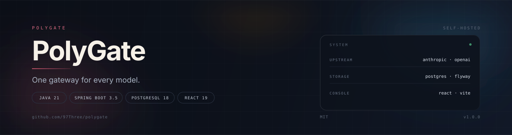
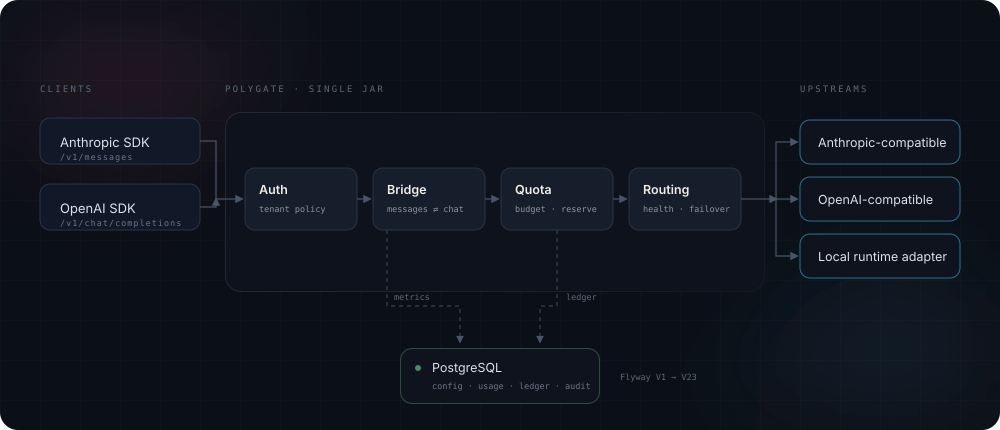

<p align="center">
  
</p>

<p align="center">
  <a href="README.md">简体中文</a> · <b>English</b>
</p>

<p align="center">
  <strong>One gateway for every model.</strong> A self-hosted boundary for authentication, routing and billing in front of Anthropic Messages and OpenAI Chat Completions — with the admin console baked into the executable JAR.
</p>

<p align="center">
  <a href="https://github.com/97Three/polygate/actions/workflows/verify-release.yml"></a>
  
  
  
  
  
  
</p>

---

## Why PolyGate

Working with several model providers is rarely about "calling an API". It is usually about keys scattered across clients, usage nobody can attribute, budgets nobody enforces, and incidents with no trace. PolyGate collapses all of that into one process:

- **One entry point** — clients only hold one set of `POLYGATE_*` credentials; upstream keys stay on the server, with rotation and failover.
- **Two protocols** — native Anthropic Messages and OpenAI Chat Completions, sharing the same routing, quota and logging path.
- **Billable by design** — price snapshots, reservations, settlement and an append-only ledger for every call; over-budget requests are rejected before they reach the upstream.
- **Governed** — tenant, project and environment scopes; model and provider grants; IP policy; dual approval; audit and retention.
- **Observable** — Prometheus metrics, per-request traces and operational incidents; all 11 console pages talk to the real API.

## Architecture

<p align="center">
  
</p>

Every request walks the same pipeline: authentication and tenant policy, protocol translation, quota and budget reservation, then routing with health checks and failover. Ledger entries, audit events and usage records are written to PostgreSQL; metrics and structured logs are emitted along the same path.

The whole gateway is a single Spring Boot process. The React console is built at package time and served from the JAR, so there is no Node runtime and no separate front-end container in production.

## Quick start

### Docker Compose (recommended)

```bash
cp .env.example .env
# replace every replace-with-* placeholder: database password, admin bootstrap password, upstream key
docker compose up -d --build
```

Then:

- Console and API: <http://127.0.0.1:18080>
- Health: <http://127.0.0.1:18080/actuator/health>
- The first start creates the `admin` account from `POLYGATE_ADMIN_BOOTSTRAP_PASSWORD`

### Build from source

```bash
# front end
cd dashboard && npm ci && npm run build && cd ..

# back end (the console bundle is packaged into the JAR)
./mvnw -B verify
java -jar target/polygate-1.0.0.jar
```

On Windows, `.\scripts\build.ps1` pins the JDK, Node and Maven cache inside `tools/`, `.m2/` and `.npm/` so the host environment stays clean.

> Persistence is off by default. Set `POLYGATE_DATABASE_ENABLED=false` to run the gateway without PostgreSQL; when enabled, Flyway applies `src/main/resources/db/migration` automatically.

## Client access

```bash
# Anthropic Messages
curl http://127.0.0.1:18080/v1/messages \
  -H "x-api-key: $POLYGATE_CLIENT_TOKEN" \
  -H "anthropic-version: 2023-06-01" \
  -H "content-type: application/json" \
  -d '{"model":"deepseek:deepseek-v4-flash","max_tokens":256,
       "messages":[{"role":"user","content":"hello"}]}'

# OpenAI Chat Completions
curl http://127.0.0.1:18080/v1/chat/completions \
  -H "Authorization: Bearer $POLYGATE_CLIENT_TOKEN" \
  -H "content-type: application/json" \
  -d '{"model":"deepseek:deepseek-v4-flash","stream":true,
       "messages":[{"role":"user","content":"hello"}]}'
```

Both paths support SSE streaming, tool calls, images and reasoning fields. Fields that cannot be translated losslessly are rejected explicitly instead of being silently dropped.

| Endpoint | Description |
|---|---|
| `POST /v1/messages` | Anthropic Messages, including streaming |
| `POST /v1/messages/count_tokens` | Upstream token counting |
| `POST /v1/chat/completions` | OpenAI Chat Completions, including streaming |
| `GET /v1/models` | Models visible to the presented credential |
| `GET /v1/effective-policy` | Effective policy for the caller |
| `GET /livez` `/readyz` `/health` | Liveness and readiness probes |
| `GET /metrics` | Prometheus metrics, protected by a bearer token |

## Configuration

Everything is injected through environment variables; see [`.env.example`](.env.example) for the full list.

| Variable | Default | Purpose |
|---|---|---|
| `POLYGATE_BIND` | `127.0.0.1` | Listen address; set `0.0.0.0` inside containers |
| `POLYGATE_PORT` | `18080` | HTTP port |
| `POLYGATE_DATABASE_ENABLED` | `false` | Enable PostgreSQL persistence |
| `POLYGATE_DATABASE_URL` | — | JDBC URL; the database must be `polygate` or `polygate_<suffix>` |
| `POLYGATE_ADMIN_BOOTSTRAP_PASSWORD` | — | Password for `admin` on a fresh database |
| `POLYGATE_CLIENT_TOKEN` | — | Shared client token (prefer per-user API keys) |
| `POLYGATE_UPSTREAM_URL` | `http://127.0.0.1:19090` | Default upstream base URL |
| `POLYGATE_UPSTREAM_KEY` | — | Default upstream key |
| `POLYGATE_UPSTREAM_PROTOCOL` | `anthropic` | `anthropic` or `openai_compat` |
| `POLYGATE_APPROVED_UPSTREAM_HOSTS` | empty | Additional allowed upstream hosts, comma separated |
| `POLYGATE_TRUSTED_PROXIES` | empty | Trusted proxy CIDRs; empty ignores forwarded headers |
| `POLYGATE_OIDC_*` | empty | Enterprise SSO; disabled until configured |

## Admin console

Served from the same JAR:

- **Overview** — traffic, latency, error rate, cost trend and health
- **Models** — providers, credential pools, catalog, aliases, canary and shadow routing
- **Users & keys** — users, teams, API key lifecycle, rotation and scope
- **Quotas & budgets** — daily/weekly/monthly quotas, reservations, settlement and adjustments
- **Request logs** — filter by status, model, latency or cost; drill into a single request
- **Enterprise** — cost centers, budget events and tenant-level usage
- **Governance** — project policy, egress boundaries, dual approval, audit and retention
- **Operations** — incidents, feedback, recovery actions and optional budget-bounded analysis
- **Settings** — runtime configuration, provider connectivity tests and hot reload

## Observability

`deploy/observability/` ships Prometheus scrape config, alert rules and a Grafana dashboard. `/metrics` exposes request volume, tokens, latency buckets, rejection reasons and ledger operations. Troubleshooting steps live in the [runbook](deploy/observability/RUNBOOK.md).

## Project layout

```text
src/main/java/dev/polygate/       gateway, routing, billing, governance, admin API
src/main/resources/db/migration/ Flyway migrations (V1 → V23)
src/main/resources/schemas/      JSON Schema for runtime adapters
dashboard/                       React 19 + Vite console
deploy/observability/            Prometheus / Grafana / runbook
scripts/                         build, deploy, backup and verification scripts
```

## Development

```bash
./mvnw -B verify                 # Java unit + integration tests (embedded PostgreSQL)
cd dashboard && npm run check    # typecheck + ESLint + Vitest + production build
```

End-to-end checks run with Playwright against a live backend:

```bash
cd dashboard
PLAYWRIGHT_BASE_URL=http://127.0.0.1:18080 \
PLAYWRIGHT_SKIP_WEBSERVER=1 npm run e2e:java
```

The `scripts/verify-*.ps1` suites exercise permissions, budgets, approval, transport, fallback and operations against an isolated database and a mock upstream.

## Security baseline

- Non-root container, read-only root filesystem, all capabilities dropped
- Argon2id admin passwords, login rate limiting, CSRF, session cookies and optional OIDC
- Client credentials stored as hashes only; upstream keys referenced through environment variables
- Hard limits on request size, concurrency, timeouts and retries
- Dual approval and full audit for high-risk changes such as budgets, policy and credentials

## License

[MIT](LICENSE)
